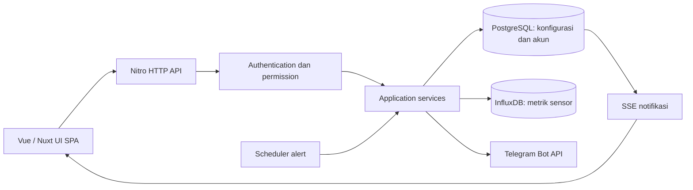

# Arsitektur aplikasi

## Komponen runtime

Nuxt memakai `ssr: false`; UI dirender browser. Nitro preset Bun menjalankan API, scheduler, dan SSE dalam proses server. PostgreSQL menyimpan state aplikasi; InfluxDB merupakan sumber eksternal. Tidak ada message broker, Redis, atau service ingestion sensor dalam stack bawaan.

## Struktur kode

| Lokasi | Tanggung jawab |
| --- | --- |
| `app/pages` | Entry route tipis, memasang feature view |
| `app/layouts`, `app/components` | Shell, navigasi, dan primitive UI bersama |
| `app/core` | HTTP client, state request, utilitas UI, permission frontend |
| `app/features/<feature>` | View, komponen, composable, dan utilitas per fitur |
| `app/assets/styles` | Token semantic dan style bersama |
| `shared/domain` | Schema Zod, type, katalog, dan aturan akses bersama |
| `shared/utils` | Fungsi murni layout, interpolasi, variable, import appearance |
| `shared/config` | Identitas produk |
| `server/api` | Adapter HTTP, validasi payload, pemanggilan service |
| `server/http`, `server/middleware` | Konteks principal, origin guard, pemetaan error |
| `server/domain` | Port repository/gateway dan model aplikasi |
| `server/features/<feature>` | Application service, domain khusus fitur, adapter infrastruktur |
| `server/platform` | Database, vault, transport HTTP, clock |
| `server/bootstrap` | Pembacaan konfigurasi dan composition root dependency injection |
| `server/plugins` | Lifecycle scheduler dan shutdown |
| `tests`, `tooling`, `docker` | Verifikasi, aturan arsitektur, deployment |

Alias: `~` menunjuk `app`, `~~` root repositori, `#shared` direktori shared. Auto-import Nuxt disetel pada [nuxt.config.ts](../../nuxt.config.ts). Jangan membuat import relatif yang mengasumsikan `~` sebagai root.

## Dependency injection

[createWorkspace](../../server/bootstrap/workspace.ts) adalah composition root yang merangkai database, repository, vault, InfluxClient, Telegram gateway, clock, dan service. `getWorkspace()` menyimpan satu container per proses. Nama internal `Workspace*` masih digunakan beberapa modul; itu identifier kode yang ada, bukan konsep produk untuk pengguna.

Application service memakai dependency constructor berupa port pada [ports.ts](../../server/domain/ports.ts). Contoh AlertService menerima repository, akses source, akses Telegram, dan Clock, sehingga unit test dapat memakai fake tanpa koneksi eksternal. Fungsi murni seperti evaluator threshold tetap berupa fungsi; OOP digunakan untuk service/lifecycle dan adapter, bukan memaksa setiap value menjadi class.

## Alur query panel

1. Composable panel membentuk QueryRequest dari source, variable, dan waktu.
2. Shared API client menangani sesi dan refresh; QueryRunner membatalkan request yang sudah diganti.
3. Middleware memvalidasi sesi, role, permission route, serta origin mutation.
4. Controller memvalidasi body dengan Zod dan menyerahkan ke DataSourceService.
5. Service membaca konfigurasi, membuka secret melalui vault, dan memanggil InfluxClient.
6. Client melakukan interpolasi, menambahkan macro waktu, mengirim request, mem-parsing CSV/JSON, dan membatasi hasil.
7. UI membentuk seri/tabel dari QueryResponse lalu menerapkan opsi visualisasi.

Semua user terautentikasi boleh query semua sumber. Hak membaca dashboard tidak digunakan sebagai ACL source.

## Alur alert dan notifikasi

Scheduler selalu aktif selama proses server berjalan, memeriksa jadwal setiap 10 detik, dan mengambil rule due, mencoba lock PostgreSQL per rule, menjalankan query dan reducer, menghitung pending/state, lalu mengirim Telegram yang diperlukan. Penyimpanan evaluasi dan event dalam aplikasi dilakukan atomik melalui repository. Delivery status Telegram dipelihara per tujuan; layanan eksternal tidak menjadi bagian transaksi SQL.

Event notifikasi persisten mempunyai sequence global. Stream server memeriksa perubahan database, memfilter permission user, dan mengirim SSE. Client memakai cursor untuk reconnect serta fallback polling. Tidak ada pub/sub process-local sebagai satu-satunya sumber kebenaran.

## Batas dependency

Domain/shared tidak boleh bergantung pada Vue, API controller, atau driver database. Komponen tidak menjalankan SQL atau membuka secret. Controller tidak menduplikasi business rules. Saat menambah fitur, gunakan [extension guide](../development/extension-guide.md) dan perbarui [inventaris](../reference/source-inventory.json).
