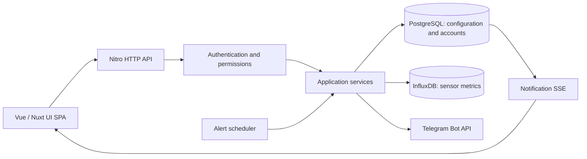

# Application architecture

## Runtime components

Nuxt uses `ssr: false`; the UI renders in the browser. Nitro's Bun preset runs the API, scheduler, and SSE in the application server process. PostgreSQL stores application state; InfluxDB is external. No message broker, Redis instance, or sensor ingestion service is bundled.

## Source structure

| Location | Responsibility |
| --- | --- |
| `app/pages` | Thin route entries mounting feature views |
| `app/layouts`, `app/components` | Shared shell, navigation, and UI primitives |
| `app/core` | HTTP client, request state, UI helpers, frontend permission checks |
| `app/features/<feature>` | Feature views, components, composables, utilities |
| `app/assets/styles` | Semantic tokens and shared styles |
| `shared/domain` | Zod schemas, types, catalogs, shared access rules |
| `shared/utils` | Pure layout, interpolation, variable, and import appearance functions |
| `shared/config` | Product identity |
| `server/api` | HTTP adapters, input validation, service calls |
| `server/http`, `server/middleware` | Principal context, request protection, error mapping |
| `server/domain` | Repository/gateway ports and application models |
| `server/features/<feature>` | Application services, feature-specific domain, infrastructure adapters |
| `server/platform` | Database, credential vault, HTTP transport, clock |
| `server/bootstrap` | Configuration and dependency injection composition root |
| `server/plugins` | Scheduler and shutdown lifecycle |
| `tests`, `tooling`, `docker` | Verification, architecture rules, deployment |

Aliases: `~` refers to `app`, `~~` to the repository root, and `#shared` to shared code. Auto-imports are configured in [nuxt.config.ts](../../nuxt.config.ts). Do not assume `~` points to the repository root.

## Dependency injection

[createWorkspace](../../server/bootstrap/workspace.ts) composes the database, repositories, vault, InfluxClient, Telegram gateway, clock, and services. `getWorkspace()` retains one container per process. Several internal modules retain `Workspace*` identifiers; these are code identifiers, not a user-facing product concept.

Application services use constructor-injected ports from [ports.ts](../../server/domain/ports.ts). AlertService, for example, receives repositories, source access, Telegram access, and a Clock, allowing unit tests to use fakes without external connections. Pure rules such as threshold evaluation remain functions. Classes handle service/adapter lifecycle rather than turning every value into an object hierarchy.

## Panel query flow

1. A panel composable builds QueryRequest from source, variables, and time state.
2. The shared API client handles sessions/refresh; QueryRunner cancels superseded requests.
3. Middleware checks the session, role, route/resource permission, and mutation origin.
4. The controller validates the body with Zod and delegates to DataSourceService.
5. The service loads configuration, decrypts credentials through the vault, and calls InfluxClient.
6. The client interpolates values, applies time macros, requests the upstream API, parses CSV/JSON, and limits results.
7. The UI builds chart series/tables from QueryResponse and applies visualization options.

All authenticated users can query every source. Dashboard permission is not a source ACL.

## Alerts and notifications

The scheduler always runs while the server process is alive. Every 10 seconds it obtains due rules, attempts per-rule PostgreSQL locks, queries/reduces values, computes pending/state, and sends required Telegram messages. Evaluation state and in-app notification events are committed atomically through the repository. Telegram delivery state is tracked per destination; external delivery is not part of the SQL transaction.

Persistent notification events use a global sequence. The server stream checks database changes, filters user access, and sends SSE. The client resumes with a cursor and falls back to polling. There is no process-local-only pub/sub source of truth.

The per-user alert pop-up preference affects client toast presentation only. It does not stop streaming, inbox updates, server evaluation, or Telegram delivery.

## Dependency boundaries

Domain/shared code must not depend on Vue, HTTP controllers, or database drivers. Components do not execute SQL or decrypt secrets. Controllers do not duplicate business rules. Follow the [extension guide](../development/extension-guide.md) and update the [inventory](../reference/source-inventory.json) when adding code.
